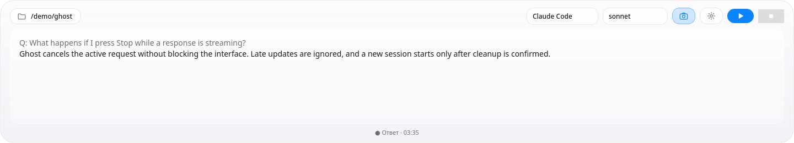
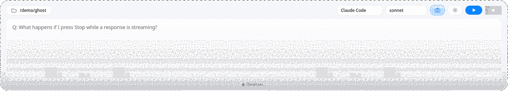
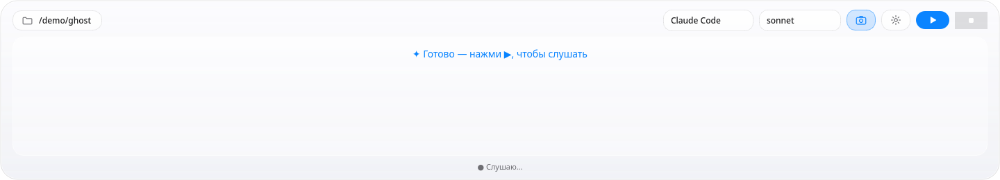

# Ghost

A desktop voice assistant for Linux that can use screen context and types answers into a compact overlay.

**[Русская версия →](README.ru.md)**



_The screenshot is a real `QWidget` render with synthetic demo text. No microphone, live model, or personal data was used._

**Stack:** Python 3 · PySide6 / Qt 6 · faster-whisper or Groq STT · Claude Code, Codex, and generic CLI adapters

## What it does

- Records a spoken question and detects the end of speech.
- Transcribes locally with `faster-whisper` or through Groq when configured.
- Adds an optional, temporary screenshot to questions that need screen context.
- Streams partial answers into an always-on-top Qt overlay.
- Lets you select a tool and model from the user-editable [`tools.yaml`](src/tools.yaml) registry.
- Cancels work without blocking the interface and waits for resource cleanup before restart.

<details>
<summary>Watch the real widget render a streamed demo answer</summary>






</details>

## How it works

```text
microphone → VAD → STT process ─┐
                                ├→ CLI model adapter → queued Qt signals → overlay
optional screen snapshot ───────┘
```

The UI stays on the Qt main thread. Audio capture, transcription, model I/O, cancellation,
and cleanup run behind explicit process and thread boundaries. See
[`docs/ARCHITECTURE.md`](docs/ARCHITECTURE.md) for the contracts between them.

## Run it

Ghost currently targets Linux desktop sessions. Install and authenticate at least one supported
model CLI, then run:

```bash
git clone https://github.com/Archangel-gabri/ghost-assistant.git
cd ghost-assistant
python3 -m venv .venv
source .venv/bin/activate
python -m pip install -r requirements.txt
./run.sh
```

The default `auto` speech backend uses Groq when `GROQ_API_KEY` is set and otherwise falls back to
local `faster-whisper`. Add another compatible command-line model in
[`src/tools.yaml`](src/tools.yaml). Run `./install.sh` if you also want an application-menu entry
and desktop shortcut.

## Limits

- A model is not bundled. Answers require a configured Claude Code, Codex, or compatible generic CLI.
- Linux audio devices, local speech models, and provider access depend on the host setup.
- Screen capture is optional and should be disabled when the visible desktop contains sensitive data.
- Offline tests exercise local subprocesses and the Qt event queue, but do not prove microphone quality,
  live provider access, or every desktop capture setup.

Dated test results, compatibility pins, and native-check evidence are kept in
[`docs/STATUS.md`](docs/STATUS.md). Contributor commands are in
[`CONTRIBUTING.md`](CONTRIBUTING.md).

## License

[MIT](LICENSE)
